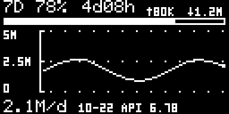
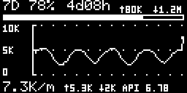

# 0.6.0账号用量、像素皮肤与0.10 OLED

本轮按用户确认的一行底栏、35像素曲线实现。Host0.6.0已安装本机；App0.10仅完成离线验证，Boot1.0保持原字节。用户将稍后通知USB升级，届时才进行新固件实机验收与GitHub推送。本轮尚未推送，也未将旧版实测结果当作0.10验收。

## 用量来源与口径

默认`usageDisplayScope=account`，旧配置缺少字段也默认整账号。托盘“用量来源”和设置“用量清单”共享该选项，切换后普通浮窗、像素浮窗、清单和目标OLED页同步；选择会保存。本机日志仍单独采集，ccusage导入继续作为独立来源，均不与账号数相加。

账号数据来自同一Codex连接的只读`account/usage/read`：可空的`summary.lifetimeTokens`和`dailyUsageBuckets[{startDate,tokens}]`。累计量、按日值均保留64位，不从7D百分比反推，不捏造输入/输出/缓存分项。该接口是服务端账号汇总，并非逐设备清单，也没有承诺秒级更新；独立API供应商余额不属于Codex账号用量。

本机2026-10-23使用新版生产Provider只读验证成功：额度与账号统计均为新鲜状态、累计量非空、180个日桶、最近统计日2026-10-22。个人Token数值、身份、认证和配置不入库。本轮未做两台电脑产生用量后的增量对照，不能额外宣称已验证每种设备/会话的覆盖与延迟。

| 页面 | 账号（默认） | 切换本机 |
|---|---|---|
| 曲线 | 最新服务端统计日及之前13天，Token/日 | 最近1小时，已上报Token/分钟 |
| 当前值 | 最新日桶；显示该桶月/日 | 当前60秒输入+输出，分项用↑/↓ |
| 普通浮窗 | 账号累计、统计日期、日用量、查询时间 | 一小时合计、输入/输出分钟活动 |
| 清单/CSV | 账号累计与已返回日桶；缺失日期不补0 | 现有本机日/会话、模型、输入/缓存/输出 |
| 不可用 | 明示缺失/过期，不自动切本机 | 沿用扫描中/部分/过期状态 |

账号汇总每5分钟自动查询；手动刷新会请求新值。查询时间表示本程序读取时间，统计日期表示服务端桶日期，两者不混用。15分钟未成功查询、连接故障、退出登录或账号切换均有相应状态；账号切换立即清除旧账号缓存，迟到响应不能恢复旧值。接口不支持时只把账号统计标为不可用，保留有效的7D额度。

## OLED与像素皮肤

顶部只按实际10080分钟窗口显示7D额度；不把5h窗口改名。曲线17–51行共35像素，3×5小字刻度标上限/中值/0。上限采用1/2/5整档并保留降档余量；本机降采样保留单点峰值，末点与当前合计一致。数据缺失断线，部分记录显示`!`。

底栏56–62行保留当前大字；账号右侧显示统计月日与`API 6.78`一类余额，本机右侧显示↑/↓与余额。`API`与数字间有一个小空格，必要时仅缩减次要分项精度以避免越界。

托盘“浮窗外观 → 像素OLED”，或设置外观第四项，可选新皮肤。逻辑画布与设备均为128×64，默认75%尺寸为384×192，整数3倍像素；保留折叠、拖动、透明度和置顶。原有皮肤保留，悬停白色信息窗继续移除。以下是合成样例，不是个人账号截图：

新增独立0x0D/0x0E消息，不修改STATUS或固定28字节PC_METRICS。Host0.6.0通过INFO识别App0.10后才发送新消息；旧固件继续正常使用原协议。App0.10页0默认账号，页4为本机，手动循环0→1→4→2→0，页2仍为账号/PC自动轮播。详细字段见[协议](PROTOCOL.md)。

## 离线验证及待办

- 生产C解析/绘图和C#像素绘图26组1024字节帧逐字节一致，覆盖不同量级、余额舍入、无上限、0/100%额度、过期、缺失、部分记录；另检查非法帧不覆盖旧数据、页切换和像素边界。
- 新账号/OLED/皮肤173项集成检查通过，包含整账号默认与保存、来源切换、旧固件禁止新消息、STATUS原字节保持和PC_METRICS恰好28字节。
- Provider新增账号隔离、迟到响应、退出登录、可选接口不支持、刷新节流/手动刷新与断连检查；额度可靠性整组零失败。
- 本机用量26项、Token HUD77项、配置可靠性、内置自检/模拟闭环/UI批量/第二阶段检查全部通过。
- 实际App0.10镜像校验9项、升级请求3项、更新器55项、Windows PowerShell5.1中文路径、USB传输22项及基础协议16项通过。模拟USB测试不是新固件实机验收。
- Demo默认账号，API间距已同步；216种离线栅格组合、刻度和数值对应检查通过。本轮未绕过浏览器本地文件限制，未宣称重新完成浏览器验收。
- CubeIDE构建0错误0警告；封装App47,408/57,344字节，剩余9,936字节；静态RAM14,728字节。Boot1.0封装1,920字节，与上一轮逐字节相同。仍需实机确认栈余量与长期稳定性。

复现入口：先运行`host/build.ps1`；`tests/oled_usage/run.ps1`需要GCC、Python、Node，可通过`-Python`/`-Node`指定路径；账号Provider检查为`tests/quota_reliability/run.ps1`；USB镜像测试指定`tests/usb_update/run.ps1 -PackageDirectory <本轮firmware/package>`。生成物只放忽略的`artifacts/oled-usage-20261023/`。

本地候选分支为`feat/account-oled-pixel-20261023`，构建与部署摘要见[本轮记录](evidence/account-oled-20261023.json)。

后续等待用户USB升级通知：确认当前设备身份及启动程序，USB仅更新应用，回读App0.10与Boot保护状态，检查账号/本机页、离线与过期显示、旋钮切页、重连和连续通信。完成本轮实机验证后再整理交付包、提交并推送GitHub分支。USB诊断计数/故障记录仍属后续规划，本轮未新增诊断协议。

来源：OpenAI官方[App Server账号用量](https://learn.chatgpt.com/docs/app-server#7-token-usage-chatgpt)。
