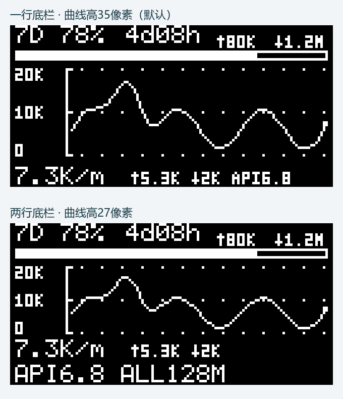

# 下一步 Demo 与 USB 调试规划

范围：本轮交付先修复 USB 升级的三项审查问题并移除浮窗悬停提示；下列是下一阶段方案。OLED 页面、账号总量曲线和新增诊断协议尚未写入当前 0.9 固件。

## OLED 额度页：能放下，先做单图切页

硬件驱动与 `app_cfg.h` 确认屏幕为 128×64 单色 OLED，现有字体 5×7，字符步进 6 像素，每行最多约 21 个 ASCII 字符。完整帧为 1024 字节，驱动已有绘制线段、像素、进度条及双缓冲发送能力。当前应用 45,384 字节，分区上限 57,344 字节，剩余 11,960 字节；实际新增固件仍须编译测量，不能用这个余量代替资源验收。

[交互 Demo](../demos/oled-quota-128x64.html) 包含原尺寸与放大预览。2026-10-23根据用户反馈移除 `LOCAL 1h TOK/m` 独立标题，将上下行网速放回右上角，提供一行/两行底栏对照；随后增加图内纵轴刻度、整档缩放与底栏当前值。常规字形复用固件5×7字体，3×5小字复用网速字形并补足刻度/底栏需要的少数字符。所有数字及曲线都是合成数据，不代表账号或实机读数。

| 区域 | 像素行 | 内容 |
|---|---|---|
| 顶部 | 0–13 | 7D余量、倒计时与进度条；右上角沿用3×5网速字形和上下箭头，位置为x=82/105、y=4 |
| 中部（默认） | 17–51 | 保留35像素高度，图内左侧以3×5小字标上限、中值和0；刻度预留22像素宽度，绘图区宽102像素 |
| 底部（默认） | 56–62 | 大字显示曲线当前值；小字用↑/↓表示输入/输出，并保留API |
| 两行底栏方案 | 曲线17–43；文字46–62 | 保留27像素曲线，第二行以更大字体显示API与账号累计量 |

默认大曲线比原版增加约84%的纵向空间。紧凑网速与7D额度、倒计时同处顶部，不占额外文字行。原 `L1h` 表示本机最近一小时，`I/O` 表示输入/输出；本轮移除这些底栏缩写，改成 `↑` 输入、`↓` 输出，大字显示合计 Token/分钟（`/m`）。账号页显示最后一天 Token/日（`/d`），不捏造接口未提供的输入/输出分项。时间范围在页面选择器和图旁说明中标清，K=千、M=百万。

刻度上限向上取 `1、2、5 × 10ⁿ` 整档，最低为1；超出当前上限立即升档，回落至较低档上限的80%才降档。例如20K越界升至50K后，在峰值降至16K之前保持50K，避免在20K附近反复跳档。上限、中值、0与绘制映射一致，末点用小方点标记。底栏数值直接取同一组样点的末值，本机输入/输出合成分项之和等于该末值，不再独立写死样例数字。

双图在一行底栏时各高16像素，两行底栏时各高12像素；为保证3×5小字可读，各只标上限和0，上限前加L/A区分来源。一行底栏同时显示两图当前值和本机输入/输出，API放入两行底栏选项。建议首版通过现有按键/旋钮切换“本机1h”和“账号14d”，电脑端分别显示两张完整曲线。两组数据各自缩放，不能直接比较峰值高度。

首版按每秒刷新状态、上位机先聚合再发送样点规划，不持续传整幅截图。新增独立协议消息，不修改 STATUS 和固定28字节 PC_METRICS v3。记录时间、来源、有效/过期/部分标记；账号累计量使用64位计数。数据缺失显示 `--` 并断开曲线，不能把未知画成0。暂不增加中文字库，详细中文说明保留在上位机。

7D窗口按服务返回的 `windowDurationMins=10080` 识别，不假定它一定处于primary或secondary；没有对应窗口时保留不可用状态。

## 白色悬浮信息窗

0.5.1 已移除额度浮窗的 ToolTip 与鼠标移动触发的说明弹窗。曲线折叠、拖动、底栏和额度刷新保留。设置保存失败时只在用户主动操作后显示错误，不在鼠标悬停时弹出信息。

## 每秒实时 Token 速率：当前程序不具备

当前曲线来自本机 Codex JSONL 的 `token_count` 记录，读取 `total_token_usage` / `last_token_usage`；服务通常每5秒扫描，曲线每10秒更新一个点，每点汇总此前60秒的已上报记录。因此它表示“本机已上报 Token/分钟”，不是 Deepseek harness 生成过程中的逐秒 tokens/s。

把最近一分钟总数除以60只能得到平均速率。记录可能成批到达，且输入含缓存、输出含推理；不能把日志晚到形成的跳变称为模型瞬时生成速度。

官方 App Server 有活动线程的 `thread/tokenUsage/updated` 和文本增量事件，但文档没有承诺每秒精确 Token 计数，也没有证明独立监控进程能订阅其他进程的全部活动。后续可单独试验“受本程序管理的会话”的流事件统计；在验证事件频率和计数口径前，继续使用清楚标注的已上报活动曲线。当前不以拦截账号请求或读取认证内容实现实时监控。

## 全设备总量：已有账号级入口，粒度不同

官方 `account/usage/read` 提供账号累计量与可选按日桶。本机 Codex `0.163.0-alpha.11` 的协议 schema 包含此方法，2026-10-23 只读调用成功：累计量非空、返回180个日桶，最近桶为2026-10-22。这确认了当前账号有可用的服务端汇总入口；这些个人数值不纳入仓库。

建议在现有 Codex RPC 连接中增加账号统计读取，展示“本机最近一小时”和“账号按日总消耗”两个独立视图，带各自的更新时间。接口没有给出每秒全设备速率或设备清单，服务端统计可能延迟。下一步需要在两台电脑各产生一段可识别用量，核对账号桶的新增量和统计口径，再把界面名称定为经过验证的覆盖范围。独立 API 供应商的用量不能自动并入 Codex 账号总量。

不从7D额度百分比反推 Token；不要求同步提示词、会话全文或认证文件；空字段保留为不可用，不填0。

## 不随身带 ST-Link 时的 USB 调试

现有 USB 更新和 KEY1 恢复可用于迭代应用固件。下一步先完善可经普通 CDC 连接读取的诊断功能：

1. 设备身份、应用/启动版本、运行时间、USB配置状态。
2. 接收/发送帧数、忙重试、队列丢弃、CRC/长度错误等计数，复用现有帧协议。
3. 有界诊断记录和用户触发的导出；复用同一串口，避免文本日志混入二进制帧。
4. 受控的软件重启与进入DFU，增加“构建→封装→升级→回读→连接检查”的开发入口。
5. 应用故障后留下可验证的简短故障记录。Boot1.0会清除复位标志，不能把应用读到的空标志当成真实复位原因；如果增加跨复位记录，先明确保存位置和生命周期。

诊断默认只读，不开放任意地址写入。日志、计数、应用更新和恢复可走 USB；断点单步、底层寄存器调试及启动程序/保护设置维护仍保留 SWD 路径。本阶段不把普通 USB 更新等同于完整硬件调试器。

## 实施顺序与验收

1. 本轮：三项升级修复、移除悬停提示、更新本机、离线与实机回归。
2. 下轮第一步：USB只读诊断与导出，先让“不带下载器”时能够定位问题。
3. 下轮第二步：读取账号统计，在电脑端验证两种曲线的口径和延迟。
4. 下轮第三步：把确认后的数据接到 OLED 单图切页，检查字体可读性、峰值保留、陈旧数据、页切换、Flash/RAM和连续通信。双图作为可选布局，不先改变日常使用页面。

初版Demo已完成18种浏览器状态、交互和390像素页面宽度检查。当前排版以实际绘制代码进行离线栅格检查：6组活动样例×3种视图×2种底栏×3种额度×2种过期状态，共216种组合无像素越界，额度0/100%端点正确、原尺寸图一致；另检查整档边界、回落余量、末点坐标/底栏数值一致和输入/输出合计。样例按钮的事件处理可改变实际曲线。内置浏览器拒绝自动打开本地file页面，因此未重新宣称浏览器交互或移动端验收；仍需刷新页面及实际OLED可读性确认。

参考：OpenAI [App Server 账号用量与限额](https://learn.chatgpt.com/docs/app-server#7-token-usage-chatgpt)、[线程用量事件](https://learn.chatgpt.com/docs/app-server)；ST [ROM DFU 协议 AN3156](https://www.st.com/resource/en/application_note/an3156-usb-dfu-protocol-used-in-the-stm32-bootloader-stmicroelectronics.pdf)。硬件像素、字体与资源数字以本仓库驱动、链接分区和已封装镜像为依据。
